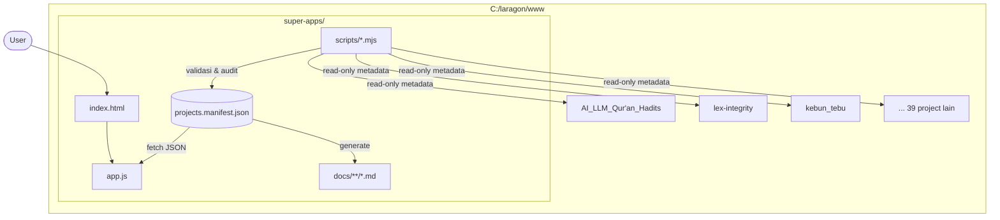

# Arsitektur Super Apps

Super Apps adalah **hub orkestrasi**, bukan aplikasi monolit. Ia tidak menyatukan kode project menjadi satu runtime; ia menyediakan satu lapisan presentasi + standar di atas project yang sudah berjalan sendiri-sendiri.

## 1. Prinsip

| Prinsip | Konsekuensi |
| --- | --- |
| **Manifest first** | Semua data project ada di `projects.manifest.json`. UI tidak boleh hardcode data. |
| **Zero-dependency shell** | Dashboard hanya `index.html` + `app.js`. Tanpa build, tanpa framework, tanpa `node_modules`. Umur panjang & tahan lama. |
| **Non-invasive** | Tidak ada satu pun file project yang diubah. Hub membaca metadata, bukan menyentuh source. |
| **Read-only federation** | Project tetap punya repo, CI, dan deploy sendiri. Hub tidak menjadi dependency runtime mereka. |
| **Satu sumber kebenaran** | Dokumentasi halaman project di-generate dari manifest agar tidak drift. |

## 2. Diagram Sistem



## 3. Alur Data

1. **Sumber** — `projects.manifest.json` diedit manual atau lewat script.
2. **Validasi** — `scripts/validate-manifest.mjs` memeriksa skema, duplikat, dan keberadaan file.
3. **Konsumsi** — browser memuat `index.html`, `app.js` mengambil manifest via `fetch`, lalu merender grup kategori + kartu.
4. **Dokumentasi** — `scripts/generate-project-docs.mjs` membuat `docs/projects/<id>.md` dari manifest.
5. **Audit** — `scripts/check-paths.mjs` dan `scripts/audit-stale.mjs` melaporkan kondisi workspace (tidak menulis apa pun).

```
edit manifest → validate → (opsional) generate docs → refresh browser
```

## 4. Komponen

### 4.1 Manifest (`projects.manifest.json`)

Menyimpan `meta`, `exclusions`, `categories`, dan `apps[]`. Detail skema di [`manifest-schema.md`](./manifest-schema.md).

### 4.2 Shell (`index.html` + `app.js`)

- Render deklaratif per kategori, dikelompokkan dengan judul.
- Filter kategori (chip) + pencarian teks (nama, tagline, stack, tag, dir).
- Tema gelap/terang dengan `localStorage`, menghormati `prefers-color-scheme`.
- Tombol salin path & buka repo.
- Aksesibilitas: `aria-pressed` pada chip, label pada input, shortcut `/` untuk fokus pencarian.

### 4.3 Skrip (`scripts/`)

| Skrip | Sifat | Fungsi |
| --- | --- | --- |
| `validate-manifest.mjs` | read-only | Validasi schema & referensi |
| `check-paths.mjs` | read-only | Cek folder project ada & tidak kosong |
| `audit-stale.mjs` | read-only | Deteksi project tanpa commit > N hari |
| `generate-project-docs.mjs` | tulis (`docs/`) | Bulk generate halaman project |
| `new-project-doc.mjs` | tulis (`docs/`) | Satu halaman project baru |

Semua skrip **zero-dependency** (Node ≥ 18, ESM).

### 4.4 Dokumentasi (`docs/`)

- `architecture/` — arsitektur, skema, landscape teknologi, ADR.
- `design/` — design system, spesifikasi dashboard, branding.
- `guides/` — cara pakai, cakupan, template, konvensi, pemeliharaan.
- `projects/` — satu halaman per project.

## 5. Non-Goals

Agar scope tidak melebar:

- ❌ Menggabungkan codebase project menjadi monorepo tunggal.
- ❌ Menjalankan ulang backend project dari dalam hub (lihat roadmap: *launcher*, opsional).
- ❌ Menjadi API gateway tunggal untuk semua project.
- ❌ Meng-copy paste kode antar project.

## 6. Evolusi yang Mungkin

Jika hub tumbuh, jalur yang masuk akal (berurutan):

1. **v1 (sekarang)** — static shell + manifest.
2. **v2** — CLI `super` (Node) untuk launcher, health check, dan sinkronisasi metadata dari git/CI.
3. **v3** — hub dinamis (SSR) dengan halaman detail, changelog aggregator, dan status deploy.

Hub tidak perlu menjadi v2/v3 sampai v1 benar-benar mengganggu.

## 7. ADR

- [ADR-0001 — Manifest JSON sebagai sumber kebenaran](./adr/0001-manifest-as-source-of-truth.md)
- [ADR-0002 — Dashboard static zero-dependency](./adr/0002-static-zero-dependency-shell.md)
- [ADR-0003 — Kriteria inklusi hanya project milik sendiri](./adr/0003-ownership-scope.md)
