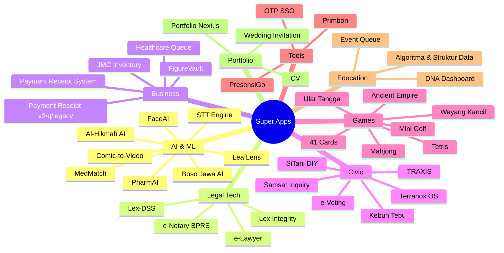

# Landscape Teknologi

Peta stack lintas 42 project, disusun dari field `stack` pada manifest. Berguna untuk menjawab: "teknologi apa yang sudah saya kuasai?", "mana project yang bisa saling berbagi pola?", "cluster mana yang paling matang?".

## Ringkasan

| Aspek | Nilai |
| --- | --- |
| Project | 42 |
| Teknologi unik tercatat | 61 |
| Bahasa dominan | TypeScript/JavaScript, Go, Python, PHP |
| Frontend dominan | React/Next.js, Vue, Angular |
| Backend dominan | Node.js/Express, Go, Django/FastAPI, Laravel |
| Database dominan | PostgreSQL (termasuk PostGIS), MySQL/SQLite |
| AI stack | LLM (OpenAI-compatible/Ollama), Whisper, TensorFlow, RAG + vector DB |

## Peta per Kategori

## Klaster Teknologi

### Go Backend (5)
`e-notary-bprs`, `e-voting-system-netizen`, `paymentreceipt-v2`, `paymentreceipt-quality`, `presensi-go`, `sitani-diy`

Pola berulang: `cmd/`, `internal/`, `migrations/`, `Taskfile`/`Makefile`, Docker multi-stage. Cocok dijadikan template bersama (**Go service starter**).

### Node.js / TypeScript (14)
`41cards`, `54-testdna`, `algorythm-and-structure-data`, `comic-to-video-ai`, `e-lawyer`, `healthcare-queue`, `jmc-inventory-app`, `lex-integrity`, `mahjong`, `medmatch`, `otp-token-sso-asn`, `traxis` (Angular), `terranox-os`, `v0-portfolio`, `wayangkancil`

### Python (8)
`al-hikmah-ai`, `boso-jawa-ai`, `comic-to-video-ai`, `face-recognition`, `leaflens`, `lex-dss`, `paymentreceiptsystem`, `pharmai`, `stt-engine`

### PHP (5)
`cv-amirul`, `invitation-wedding`, `kebun-tebu`, `paymentreceipt` (legacy), `tetris`

### Java (1)
`prime-g-collectibles` — Spring Boot reference.

### Game Engines
`ancient-empire-pc` (Godot), sisanya HTML5 Canvas.

## Teknologi Lintas-Project

| Teknologi | Dipakai di | Catatan |
| --- | --- | --- |
| PostgreSQL | 10+ project | Standar DB. Gunakan PostGIS bila spasial. |
| Docker Compose | 20+ project | Convenience lokal; deploy bervariasi (Vercel, Railway, VPS, Fly) |
| LLM lokal (Ollama) | lex-integrity, boso-jawa-ai, al-hikmah-ai | Pola RAG berulang → kandidat *shared skill* |
| Whisper | stt-engine | Bisa dipakai ulang untuk transkrip project lain |
| OpenCV | face-recognition | |
| Leaflet / PostGIS | kebun-tebu, sitani-diy, terranox-os, traxis | Klaster GIS terbesar — layak disatukan sebagai **GIS starter** |
| Keycloak | e-notary-bprs | SSO pattern |

## Polaritas & Konsistensi

Yang sudah konsisten:
- Pemisahan frontend/backend pada mayoritas project.
- Docker Compose untuk lingkungan lokal.
- README sebagai dokumentasi utama.

Yang belum konsisten (kandidat standardisasi):
- Struktur folder backend (Go: `cmd/internal` vs `app/`).
- Nama file dokumentasi (`README.md` vs `readme.md`).
- Manajemen env (`.env.example` vs dokumentasi saja).
- Sebagian project belum punya README (`invitation-wedding`).

Rekomendasi jangka panjang ada di [`../roadmap.md`](../roadmap.md).

## Matriks Maturitas

| Tingkat | Kriteria | Contoh |
| --- | --- | --- |
| **Riset / eksperimen** | Inti sudah jalan, belum ada docs | dna-dashboard, samsat-inquiry |
| **Berfungsi** | Bisa dijalankan, README dasar | primbon-app, mini-golf, ular-tangga |
| **Terawat** | Docs lengkap, CI/test, deploy | lex-integrity, presensi-go, kebun-tebu, stt-engine |
| **Portofolio** | Layak ditunjukkan publik | al-hikmah-ai, lex-dss, terranox-os, traxis |

Status ini bisa berbeda dari `status` di manifest — `status` menandai *aktivitas*, maturitas menandai *kualitas*.
