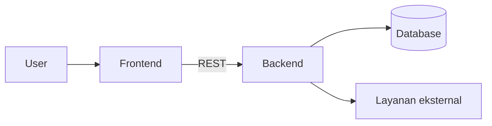

# Template Dokumentasi Project

Salin template ini ke `docs/projects/<id>.md`. Halaman di-generate otomatis dari manifest, lalu **diperkaya manual** pada bagian yang bertanda `TODO`.

> Generator: `node scripts/new-project-doc.mjs <id>` atau `node scripts/generate-project-docs.mjs`.
> Jangan mengubah nama file — ia harus sama dengan `apps[].id`.

---

```markdown
# <Nama Produk>

> <Tagline satu baris — sama dengan manifest.>

| | |
| --- | --- |
| **ID** | `<id>` |
| **Folder** | `C:/laragon/www/<dir>` |
| **Kategori** | <Kategori> (`<id-kategori>`) |
| **Status** | `active` \| `maintenance` \| `archived` |
| **Entry point** | `<entry>` |
| **Repository** | <URL> atau _(lokal, tanpa remote)_ |
| **Stack** | A, B, C |
| **Tags** | `tag1`, `tag2` |

## Ringkasan

2–3 paragraf: masalah apa yang dipecahkan, siapa penggunanya, dan apa nilai utamanya.
Hindari jargon pemasaran; tulis seolah pembaca adalah diri sendiri 6 bulan mendatang.

## Fitur Utama

- **Fitur A** — satu kalimat, apa yang dilakukan pengguna.
- **Fitur B** — …
- **Fitur C** — …

## Arsitektur

Ringkas lapisan sistem. Sertakan diagram hanya bila menambah informasi.



**Keputusan penting** dan alasannya (1–3 poin).

## Menjalankan Lokal

**Prasyarat**: runtime + versi, database, layanan eksternal.

```bash
cd C:/laragon/www/<dir>
# install
# migrate
# run
```

Akses di `http://localhost:<port>`.

## Konfigurasi Environment

| Variabel | Wajib | Keterangan |
| --- | --- | --- |
| `DATABASE_URL` | ya | Koneksi database |
| `<VAR>` | tidak | — |

> Jangan commit nilai rahasia. Simpan contoh di `.env.example`.

## Dokumentasi Internal Project

- `README.md` — ringkasan project
- `<file lain>`

## Status & Catatan Pemeliharaan

- **Terakhir diaudit**: YYYY-MM-DD
- **Kematangan**: riset / berfungsi / terawat / portofolio
- **Utang teknis**: …
- **Risiko**: …
- **Rencana berikutnya**: …

## Riwayat

| Tanggal | Perubahan |
| --- | --- |
| YYYY-MM-DD | … |
```

---

## Kaidah Penulisan

| Kaidah | Alasan |
| --- | --- |
| Bahasa Indonesia baku, kalimat pendek | Konsisten dengan dokumentasi hub lain |
| Path memakai format `C:/laragon/www/...` (garis miring) | Menghindari masalah escape di Markdown/JSON |
| Tidak ada rahasia, token, atau URL internal | Dokumen bisa dipublikasikan |
| Satu topik per bagian | Mudah di-scan dan di-diff |
| Blok kode selalu diberi tag bahasa | Render benar & copy-friendly |

## Referensi

- [`../architecture/manifest-schema.md`](../architecture/manifest-schema.md) — field yang mengisi bagian tabel
- [`../guides/conventions.md`](./conventions.md) — konvensi penulisan
