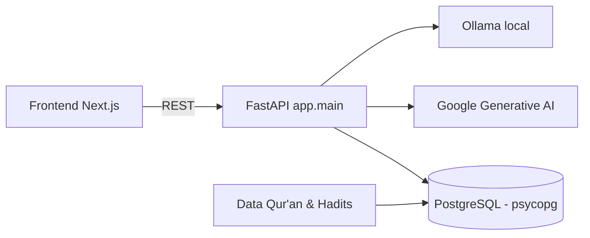

# Al-Hikmah AI

> Platform Qur'an & Hadits berbasis AI

| | |
| --- | --- |
| **ID** | `al-hikmah-ai` |
| **Folder** | `C:/laragon/www/AI_LLM_Qur'an_Hadits` |
| **Kategori** | AI & Machine Learning (`ai-ml`) |
| **Status** | `active` |
| **Entry point** | `app/main.py` (FastAPI) + `frontend/` |
| **Repository** | <https://github.com/AmirulJusticia0507/AI_LLM_Quran_Hadits.git> |
| **Stack** | FastAPI, Ollama, Google Generative AI, PostgreSQL, Next.js |
| **Tags** | `quran`, `hadits`, `rag`, `nlp` |

> **Catatan path**: folder ini bernama `AI_LLM_Qur'an_Hadits` (mengandung apostrof dan spasi).
> ID katalog sengaja `al-hikmah-ai` agar aman dipakai di URL dan nama file dokumentasi.
> Saat memakai perintah shell, **selalu bungkus path dengan tanda kutip**.

## Ringkasan

Asisten berbasis AI untuk eksplorasi Qur'an dan Hadits: pencarian semantik, penjelasan ayat,
dan penelusuran hadits yang relevan. Backend FastAPI memakai **LLM lokal (Ollama)** maupun
**Google Generative AI** sebagai fallback, dengan PostgreSQL untuk penyimpanan data.

Project dengan riwayat commit terbanyak di klaster AI (93 commit), memiliki dokumen desain sistem
(`Sistem_AI_LLM_Quran_Hadits.md`) dan daftar pekerjaan terpisah.

## Fitur Utama

- **Pencarian semantik ayat & hadits** — berbasis embedding/LLM.
- **Dual provider LLM** — Ollama lokal atau Google Generative AI.
- **Frontend terpisah** — `npm run dev:frontend` (Next.js).
- **Satu perintah untuk semua** — `npm run dev` menjalankan backend + frontend bersamaan.

## Arsitektur



**Keputusan penting**

| Keputusan | Alasan |
| --- | --- |
| FastAPI | Async, cocok untuk panggilan LLM yang lambat |
| Ollama sebagai default | Hemat biaya & data tetap lokal |
| Google GenAI sebagai alternatif | Kualitas jawaban lebih tinggi bila kuota tersedia |
| PostgreSQL (psycopg 3) | Data terstruktur ayat/hadits + metadata |

## Menjalankan Lokal

Prasyarat: Python 3.10+, Node.js, PostgreSQL, Ollama (opsional bila memakai Google GenAI).

```powershell
cd "C:\laragon\www\AI_LLM_Qur'an_Hadits"

npm run install:all    # npm install + frontend install + pip install
npm run dev            # backend :8000 (uvicorn --reload) + frontend
```

Perintah lain:

| Perintah | Fungsi |
| --- | --- |
| `npm run dev:backend` | Hanya FastAPI (`uvicorn app.main:app --port 8000 --reload`) |
| `npm run dev:frontend` | Hanya frontend |
| `npm run build` | Build frontend |

Backend: `http://localhost:8000` · Frontend: port dev Next.js.

## Konfigurasi Environment

Dari `requirements.txt` dan `Dockerfile`/`.env.example`:

| Variabel | Keterangan |
| --- | --- |
| `DATABASE_URL` / parameter psycopg | Koneksi PostgreSQL |
| `GOOGLE_API_KEY` | Kredensial Google Generative AI |
| `OLLAMA_HOST` | Endpoint server Ollama (default lokal) |

> Jangan commit `.env`. Gunakan `.env.example` sebagai acuan.

## Dokumentasi Internal Project

- `README.md`
- `Sistem_AI_LLM_Quran_Hadits.md` — desain sistem
- `TODO_AlHikmahAI.md` — rencana kerja
- `docs/`, `tests/`

## Status & Catatan Pemeliharaan

- **Terakhir diaudit**: 2026-10-26
- **Kematangan**: terawat
- **Utang teknis**: nama folder dengan apostrof menyulitkan tooling dan shell — pertimbangkan rename ke `al-hikmah-ai` (lalu perbarui `dir` di manifest)
- **Risiko**: biaya & kuota API Google; kualitas jawaban harus disertai sitasi agar tidak menyesatkan
- **Rencana**: tambah evaluasi kualitas jawaban (golden set ayat/hadits)

## Riwayat

| Tanggal | Perubahan |
| --- | --- |
| 2026-10-26 | Halaman dokumentasi diperkaya dari `package.json`, `requirements.txt`, dan README. |
