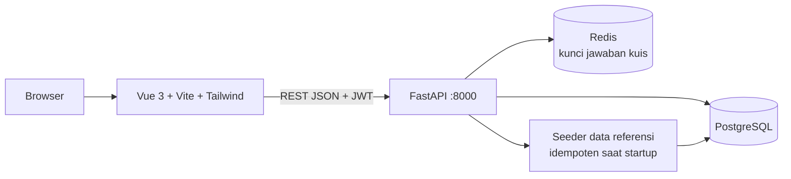

# BioChemVerse

> Ekosistem interaktif kimia, sains forensik, dan anatomi manusia 3D

| | |
| --- | --- |
| **ID** | `biochemverse` |
| **Folder** | `C:/laragon/www/BioChemVerse` |
| **Kategori** | Education & Experiments (`education`) |
| **Status** | `active` |
| **Entry point** | `frontend/` |
| **Repository** | <https://github.com/AmirulJusticia0507/BioChemVerse.git> |
| **Live** | <https://biochemverse.vercel.app/> |
| **Stack** | Vue, Vite, Tailwind CSS, Three.js, FastAPI, Python, PostgreSQL, Redis, Go |
| **Tags** | `chemistry`, `periodic-table`, `forensic`, `anatomy`, `3d`, `education` |

## Ringkasan

BioChemVerse adalah platform edukasi berbasis web yang menggabungkan tiga modul dalam satu pintu masuk: **ChemSphere** (kimia — tabel periodik, kalkulator stoikiometri, kuis, bookmark), **ForensiLab** (gim investigasi sains forensik), dan **AnatomiMed** (simulasi anatomi & diagnosis pasien 3D).

Sasarannya adalah pelajar dan pengajar yang membutuhkan materi kimia interaktif tanpa memasang perangkat lunak khusus: semuanya berjalan di browser, data referensi tersimpan terpusat, dan progres belajar pengguna terkait akun.

Nilai utamanya ada pada penggabungan domain yang biasanya terpisah — kimia, forensik, dan anatomi — dalam satu basis data dan satu sistem autentikasi, sehingga konten dapat ditautkan antar-modul.

## Fitur Utama

- **Tabel periodik 118 unsur** (nama Indonesia) dengan halaman detail properti fisika-kimia, kategori, dan ion poliatomik.
- **Alat belajar**: halaman Bandingkan unsur (sampai 4 unsur berdampingan), flashcard, tren elektronegativitas, dan tabel kelarutan garam.
- **Kalkulator stoikiometri**: massa molar, penyetaraan persamaan reaksi (eliminasi Gauss-Jordan), konversi mol/massa/partikel/volume, serta molaritas & pengenceran — dilengkapi unit test mesin rumus.
- **Kuis tabel periodik**: soal dibangkitkan di server (kunci jawaban disimpan di Redis, TTL 1 jam, sekali pakai), skor, pembahasan, dan riwayat percobaan.
- **Bookmark unsur** per pengguna, tersinkron antara halaman detail unsur dan halaman daftar bookmark.
- **Anatomi 3D interaktif** (Three.js): kerangka tubuh pria & wanita, sorotan bagian tubuh dengan fokus kamera, ilustrasi struktur, dan menu Operasi berisi katalog prosedur bedah.
- **Autentikasi JWT** (register, login, profil) dengan bcrypt, serta endpoint CRUD progres modul.

## Arsitektur



- **Frontend** `frontend/`: Vue 3 + vue-router + Tailwind CSS 4 + Three.js, dibangun dengan Vite (termasuk `vite-plugin-pwa`). Halaman di-*lazy load* per rute.
- **Backend utama** `backend/python/`: FastAPI dengan `asyncpg` (PostgreSQL) dan `redis.asyncio` (RESP2). Skema dijalankan idempoten saat startup; data 118 unsur di-seed ke PostgreSQL.
- **Backend Go** `backend/go/`: stub health-check pada port 8001, dipakai jalur CI (`go vet`/`go build`) dan CD.
- **Data & layanan**: PostgreSQL + Redis (lihat `docker-compose.yml`).

## Menjalankan Lokal

```bash
cd C:/laragon/www/BioChemVerse

# 1. Infrastruktur (PostgreSQL + Redis)
docker compose up -d

# 2. Backend API
cd backend/python
pip install -r requirements.txt
uvicorn main:app --reload --port 8000

# 3. Frontend (terminal lain)
cd frontend
npm install
npm run dev          # http://localhost:5173
npm test             # unit test mesin rumus & stoikiometri
npm run build
```

Prasyarat: Node.js 20+, Python 3.13 (lihat CI), PostgreSQL, Redis. Dokumentasi API: `http://localhost:8000/docs`.

## Konfigurasi Environment

Disalin dari `.env.example` di root menjadi `.env`.

| Variabel | Wajib | Keterangan |
| --- | --- | --- |
| `ENV` | ya | `development` / `production`. Mode development mengizinkan CORS localhost semua port & membuat akun demo. |
| `PORT` | ya | Port FastAPI (default `8000`). |
| `DATABASE_URL` | ya | Koneksi PostgreSQL, mis. `postgresql://postgres@localhost:5432/biochemverse`. |
| `REDIS_URL` | ya | Koneksi Redis, mis. `redis://localhost:6379/0`; dipakai juga untuk menyimpan kunci jawaban kuis. |
| `CORS_ORIGINS` | ya | Daftar origin dipisah koma; berlaku ketat di luar mode development. |
| `JWT_SECRET` | ya | String acak minimal 32 karakter. |
| `FRONTEND_URL` | ya | Dipakai untuk tautan reset password. |
| `RESEND_API_KEY` | opsional | Pengiriman email reset password. |
| `EMAIL_FROM` | opsional | Alamat pengirim email. |
| `SEED_ADMIN_*` / `SEED_USER_*` | opsional | Kredensial akun demo; hanya dibuat saat `ENV=development`. |

> Catatan keamanan: jangan jalankan seed akun demo dengan `ENV=production`; password default (`Admin123!`, `Demo123!`) bersifat publik.

## Dokumentasi Internal Project

- `README.md`
- `AGENTS.md`
- `TODO.md`

## Status & Catatan Pemeliharaan

- Terakhir diaudit: 2026-10-26
- Status: `active`
- Risiko teknis: kunci jawaban kuis bergantung pada Redis (tanpa Redis, `/quiz/start` mengembalikan 503); `backend/go` masih stub sehingga belum melayani logika bisnis; bundle frontend utama >500 kB dan perlu *code splitting*.
- Rencana berikutnya: lihat `TODO.md` di project (seluruh task ChemSphere sudah selesai).

## Riwayat

| Tanggal | Perubahan |
| --- | --- |
| 2026-10-26 | Halaman dokumentasi dibuat dari manifest. |
| 2026-10-29 | Ditambahkan ke katalog Super Apps (entri manifest + junction). |
| 2026-10-29 | URL live `https://biochemverse.vercel.app/` dicatat pada field `url` manifest (tombol **Live ↗** di dashboard). |
