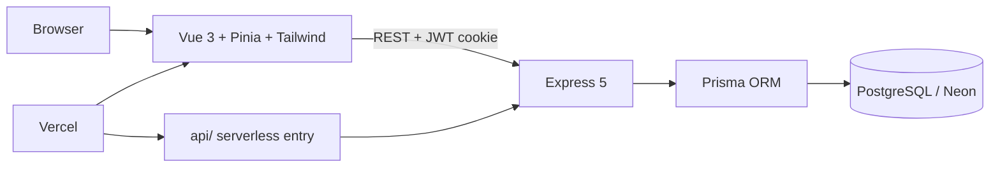

# ChemSphere

> Aplikasi pembelajaran kimia: tabel periodik, kuis, kalkulator stoikiometri, panel admin

| | |
| --- | --- |
| **ID** | `chemsphere` |
| **Folder** | `C:/laragon/www/ChemSphere` |
| **Kategori** | Education & Experiments (`education`) |
| **Status** | `active` |
| **Entry point** | `frontend/` |
| **Repository** | <https://github.com/AmirulJusticia0507/ChemSphere.git> |
| **Stack** | Vue, Vite, Tailwind CSS, Pinia, Express, Prisma, PostgreSQL, Vercel |
| **Tags** | `chemistry`, `periodic-table`, `quiz`, `stoichiometry`, `education` |

## Ringkasan

ChemSphere adalah aplikasi web pembelajaran kimia untuk menjelajahi tabel periodik, ion poliatomik, kuis, dan kalkulator stoikiometri, dilengkapi panel admin untuk pengelolaan data.

ChemSphere adalah **pendahulu BioChemVerse**: sebagian besar fiturnya (tabel periodik, kuis, kalkulator stoikiometri, bandingkan, belajar, bookmark) telah diport ke BioChemVerse dengan backend FastAPI. Project ini tetap dipertahankan sebagai referensi implementasi asli berbasis Express + Prisma.

## Fitur Utama

- Tabel periodik dan halaman detail unsur, termasuk ion poliatomik.
- Kuis dengan soal yang dibangkitkan dari database dan riwayat percobaan.
- Kalkulator stoikiometri (massa molar, penyetaraan reaksi, konversi mol, larutan).
- Halaman bandingkan unsur, ruang belajar (flashcard/tren/kelarutan), dan bookmark.
- Panel admin untuk pengelolaan data.
- Autentikasi JWT memakai access + refresh token melalui httpOnly cookie.

## Arsitektur



```text
ChemSphere/
├── backend/   # REST API Express + Prisma
├── frontend/  # SPA Vue 3
├── api/       # Vercel serverless entry
└── docs/      # Aset pendukung
```

## Menjalankan Lokal

```bash
cd C:/laragon/www/ChemSphere

npm install                 # root (tooling lint/format)
cd backend && npm install
npm run migrate             # prisma migrate dev
npm run seed                # isi data awal
npm run dev                 # API Express

cd ../frontend && npm install
npm run dev                 # SPA Vite
npm test                    # unit test mesin rumus
```

Dari root tersedia `npm run dev:backend` dan `npm run dev:frontend`. Prasyarat: Node.js, PostgreSQL (lokal atau Neon).

## Konfigurasi Environment

File contoh: `backend/.env.example`; di frontend gunakan `frontend/.env`.

| Variabel | Wajib | Keterangan |
| --- | --- | --- |
| `PORT` | ya | Port API Express. |
| `NODE_ENV` | ya | `development` / `production`. |
| `DATABASE_URL` | ya | Koneksi PostgreSQL (Neon pada deployment). |
| `JWT_SECRET` | ya | Kunci access token. |
| `JWT_ACCESS_EXPIRES_IN` | ya | Masa berlaku access token. |
| `JWT_REFRESH_SECRET` | ya | Kunci refresh token (berbeda dari access). |
| `JWT_REFRESH_EXPIRES_IN` | ya | Masa berlaku refresh token. |
| `APP_URL` | ya | URL aplikasi, dipakai untuk CORS/tautan. |
| `CORS_ORIGIN` | ya | Origin frontend yang diizinkan. |
| `SEED_ADMIN_EMAIL` / `SEED_ADMIN_PASSWORD` | opsional | Akun admin awal untuk seed. |
| `LOG_LEVEL` | opsional | Tingkat log. |
| `ERROR_REPORTING_URL` / `ERROR_REPORTING_TOKEN` | opsional | Endpoint pelaporan error. |

> Jangan commit `.env` / `.env.local` — keduanya berisi kredensial nyata.

## Dokumentasi Internal Project

- `README.md`
- `AGENTS.md`
- `TODO.md`

## Status & Catatan Pemeliharaan

- Terakhir diaudit: 2026-10-26
- Status: `active` — fitur utamanya sudah direplikasi di BioChemVerse, sehingga pengembangan baru sebaiknya diarahkan ke sana.
- Catatan: project memakai `node_modules` dan `.vercel` lokal; state kuis disimpan in-memory di proses Express (di BioChemVerse diganti Redis).

## Riwayat

| Tanggal | Perubahan |
| --- | --- |
| 2026-10-29 | Didaftarkan ke katalog Super Apps (entri manifest + halaman dokumentasi). |
