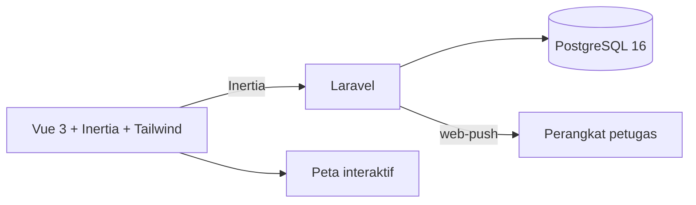

# Kebun Tebu

> Monitoring kebun tebu berbasis peta

| | |
| --- | --- |
| **ID** | `kebun-tebu` |
| **Folder** | `C:/laragon/www/kebun_tebu` |
| **Kategori** | Civic & Public Sector (`civic`) |
| **Status** | `active` |
| **Entry point** | `artisan` |
| **Repository** | <https://github.com/AmirulJusticia0507/kebun_tebu.git> |
| **Stack** | Laravel, PHP, Vue 3, Inertia, PostgreSQL, Leaflet |
| **Tags** | `agriculture`, `mapping`, `laravel`, `pwa` |

## Ringkasan

Aplikasi web **mobile-first** untuk melaporkan dan memonitor kejadian lapangan di perkebunan tebu
(kebakaran, hama, penyakit, banjir) secara real-time di atas peta interaktif.

Stack modern Laravel: Inertia + Vue 3, PostgreSQL 16, PWA-ready, serta web push notification.
Dokumentasi internal sangat lengkap (spesifikasi MVP, rencana implementasi, dokumentasi API, panduan deploy).

## Fitur Utama

- **Pelaporan kejadian** — petugas melaporkan kejadian lapangan dari perangkat mobile.
- **Peta monitoring** — sebaran kejadian real-time.
- **Notifikasi push** — `minishlink/web-push` untuk peringatan.
- **RBAC** — `spatie/laravel-permission` (peran petugas/admin).
- **Activity log** — `spatie/laravel-activitylog` untuk jejak audit.
- **PWA** — dapat dipasang di perangkat lapangan dengan koneksi terbatas.

## Arsitektur



**Keputusan penting**

| Keputusan | Alasan |
| --- | --- |
| Inertia + Vue | SPA tanpa memisahkan API dari server-side routing Laravel |
| PostgreSQL | Kebutuhan query spasial/geo untuk peta |
| PWA + web push | Petugas lapangan sering bekerja dengan koneksi tidak stabil |
| Spatie permission | Kebutuhan peran berlapis (petugas, admin) tanpa membangun dari nol |

## Menjalankan Lokal

Prasyarat: PHP 8.2+, Composer, Node.js, PostgreSQL 16.

```bash
cd C:/laragon/www/kebun_tebu

composer install
npm install

cp .env.example .env
php artisan key:generate
php artisan migrate

npm run dev        # Vite dev server
php artisan serve  # backend
```

## Konfigurasi Environment

Lihat `.env.example`. Kunci utama: koneksi PostgreSQL, konfigurasi web push (VAPID),
dan URL aplikasi.

## Dokumentasi Internal Project

- `README.md` — gambaran umum lengkap
- `Spesifikasi_MVP_Kebun_Tebu.md` — batas MVP
- `API_DOCUMENTATION.md` — kontrak API
- `IMPLEMENTATION_PLAN.md` — rencana kerja
- `DEPLOYMENT.md` — panduan deploy
- `TODO_AUDIT.md` — catatan audit
- `CHANGELOG.md`

## Status & Catatan Pemeliharaan

- **Terakhir diaudit**: 2026-10-26
- **Kematangan**: terawat (docs, API spec, deploy, audit)
- **Utang teknis**: `TODO_AUDIT.md` perlu ditindaklanjuti/disinkronkan
- **Risiko**: data koordinat kebun harus akurat; web push bergantung izin pengguna
- **Rencana**: analitik tren kejadian per musim tanam

## Riwayat

| Tanggal | Perubahan |
| --- | --- |
| 2026-10-26 | Halaman dokumentasi diperkaya dari README, `composer.json`, dan daftar docs. |
