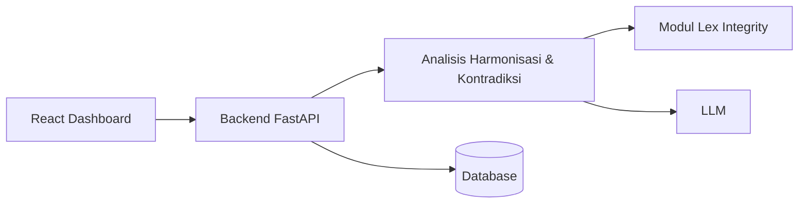

# Lex-DSS

> Decision Support System hukum berbasis AI

| | |
| --- | --- |
| **ID** | `lex-dss` |
| **Folder** | `C:/laragon/www/lex-dss` |
| **Kategori** | Legal Tech (`legal`) |
| **Status** | `active` |
| **Entry point** | `backend/` |
| **Repository** | <https://github.com/AmirulJusticia0507/lex-dss.git> |
| **Stack** | FastAPI, React, LLM |
| **Tags** | `legal`, `decision-support`, `rag`, `harmonisasi` |

## Ringkasan

Sistem pendukung keputusan untuk **analisis harmonisasi, kontradiksi, dan rekomendasi legal opinion**
pada hukum Indonesia. Mengintegrasikan modul **Lex Integrity** (pendeteksi kontradiksi norma)
ke dalam platform AI decision support.

Penilaian didasarkan pada tiga sistem hukum:

1. **Tata negara & administrasi** — hierarki perundang-undangan (Pasal 7 UU 12/2011),
   asas *lex superior*, *lex specialis*, *lex posterior*.
2. **Pidana** — asas legalitas (Pasal 1 ayat (1) KUHP / UU 1/2023), kontradiksi unsur tindak pidana,
   *overlapping penalty*.
3. **Perdata** — analisis hubungan keperdataan.

## Fitur Utama

- **Deteksi kontradiksi norma** — internal (dalam satu peraturan) & eksternal (antar peraturan).
- **Analisis hierarki** — memeriksa kesesuaian dengan peraturan di atasnya.
- **Rekomendasi legal opinion** — keluaran terstruktur, bukan jawaban bebas.
- **Integrasi Lex Integrity** — berbagi pipeline deteksi kontradiksi.

## Arsitektur



**Keputusan penting**

| Keputusan | Alasan |
| --- | --- |
| Modul per cabang hukum | Aturan penilaian berbeda tajam antar sistem hukum |
| Integrasi Lex Integrity | Hindari menulis ulang logika deteksi kontradiksi |
| Output terstruktur | DSS harus bisa dipertanggungjawabkan, bukan narasi bebas |

## Menjalankan Lokal

Prasyarat: Python 3.10+, Node.js, database.

```bash
cd C:/laragon/www/lex-dss
./start.sh          # skrip start yang disediakan repo
```

Alternatif manual: jalankan backend (`backend/`) lalu frontend (`frontend/`) sesuai README masing-masing.

## Dokumentasi Internal Project

- `README.md` — latar belakang hukum, konsep, arsitektur
- `INTEGRASI_LEX_INTEGRITY.md` — cara modul Lex Integrity dipakai
- `VERCEL_DEPLOYMENT.md` — panduan deploy
- `docs/`

## Status & Catatan Pemeliharaan

- **Terakhir diaudit**: 2026-10-26
- **Kematangan**: portofolio (dokumentasi konsep kuat, 91 commit)
- **Catatan hukum**: keluaran AI **bukan** nasihat hukum resmi — harus disertai sitasi dan disclaimer
- **Risiko**: perubahan regulasi membuat basis pengetahuan cepat basi
- **Rencana**: evaluasi presisi deteksi kontradiksi terhadap kasus uji berlabel

## Riwayat

| Tanggal | Perubahan |
| --- | --- |
| 2026-10-26 | Halaman dokumentasi diperkaya dari README (latar belakang & asas hukum). |
