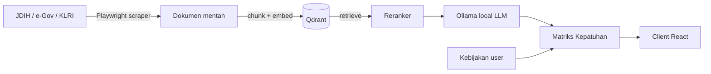

# Lex Integrity

> Matriks kepatuhan kebijakan & regulasi lokal (MERN + local LLM)

| | |
| --- | --- |
| **ID** | `lex-integrity` |
| **Folder** | `C:/laragon/www/lex-integrity` |
| **Kategori** | Legal Tech (`legal`) |
| **Status** | `active` |
| **Entry point** | `server/` (backend) + `client/` (frontend) |
| **Repository** | <https://github.com/AmirulJusticia0507/lex-integrity.git> |
| **Stack** | MERN, Ollama, Qdrant, Playwright, Docker |
| **Tags** | `compliance`, `scraper`, `local-llm`, `jdih` |

## Ringkasan

Platform untuk menyusun **matriks kepatuhan** antara kebijakan organisasi dan peraturan yang berlaku.
Sistem mengumpulkan regulasi (scraper JDIH), memprosesnya dengan **LLM lokal** (Ollama) menjadi representasi
yang dapat dicari (Qdrant), lalu memetakan pasal/kewajiban ke butir kebijakan pengguna.

Ini adalah project paling matang di klaster legal-tech: 179 commit, dokumentasi internal lengkap
(rencana proyek, panduan RAG, panduan self-host), dan pipeline scraping multi-negara
(Jepang e-Gov, Korea KLRI, JDIH nasional & daerah).

## Fitur Utama

- **Scraping regulasi** — Jepang (e-Gov), Korea (KLRI), JDIH nasional & daerah (MA, KPU, Kemendagri, Sleman).
- **Pemrosesan RAG** — chunking, embedding, retrieval dengan reranker; store di Qdrant.
- **Matriks kepatuhan** — pemetaan kewajiban regulasi ↔ butir kebijakan, dengan skor kesesuaian.
- **Local-first AI** — Ollama berjalan lokal; tidak bergantung API berbayar.
- **Multi-bahasa dokumen** — pipeline impor per yurisdiksi.

## Arsitektur



**Keputusan penting**

| Keputusan | Alasan |
| --- | --- |
| LLM lokal (Ollama) | Dokumen kebijakan bersifat sensitif; hindari kirim ke API pihak ketiga |
| Qdrant sebagai vector store | Self-host mudah, filter metadata kuat |
| Scraper per-yurisdiksi | Struktur tiap portal JDIH berbeda; dipisah agar mudah dirawat |
| Reranker terpisah | Meningkatkan presisi retrieval pada pasal yang mirip |

## Menjalankan Lokal

Prasyarat: Node ≥ 18, Python 3 (untuk scraper), Ollama, Qdrant.

```bash
cd C:/laragon/www/lex-integrity
npm install

# Jalankan server + client bersamaan
npm run dev

# Dengan stack AI (server, client, ollama, ngrok)
npm run dev:ai
```

Perintah lain yang tersedia (dari `package.json`):

| Perintah | Fungsi |
| --- | --- |
| `npm start` | Jalankan server produksi |
| `npm run build` | Build client |
| `npm test` | Test server & client |
| `npm run lint` | ESLint server & client |
| `npm run scrape:japan` / `import:japan` | Scrape & impor regulasi Jepang |
| `npm run scrape:korea` / `import:korea` | Scrape & impor regulasi Korea |
| `npm run sync:ollama` | Sinkronisasi tunnel Ollama |

## Konfigurasi Environment

Lihat `.env.example`. Variabel kunci (dari referensi deployment):

| Variabel | Keterangan |
| --- | --- |
| Koneksi MongoDB | Database utama |
| Koneksi Qdrant | Vector store |
| `OLLAMA_*` | Endpoint & model LLM lokal |

## Dokumentasi Internal Project

- `README.md` — gambaran umum
- `PROJECT_PLAN.md` — rencana & ruang lingkup
- `RAG_GUIDELINE.md` — panduan retrieval-augmented generation
- `SELF_HOST_LAPTOP.md` — menjalankan seluruh stack di laptop
- `DEPLOY_RAILWAY.md`, `DEPLOY_DOMAINESIA.md` — panduan deploy
- `JAPAN_EGOV_SCRAPER.md`, `graph.md`, `forms.md`, `guideline.md`

## Status & Catatan Pemeliharaan

- **Terakhir diaudit**: 2026-10-26
- **Kematangan**: terawat (dokumentasi, test, deploy terdokumentasi)
- **Utang teknis**: log scraper tersimpan di root (`jdih_*.log`, `pg.log`) — sebaiknya dipindah/di-gitignore
- **Risiko**: ketergantungan pada struktur HTML portal JDIH yang bisa berubah kapan saja
- **Rencana**: perluas cakupan yurisdiksi; tambah regression test untuk parser scraper

## Riwayat

| Tanggal | Perubahan |
| --- | --- |
| 2026-10-26 | Halaman dokumentasi diperkaya dari `package.json`, README, dan struktur repo. |
