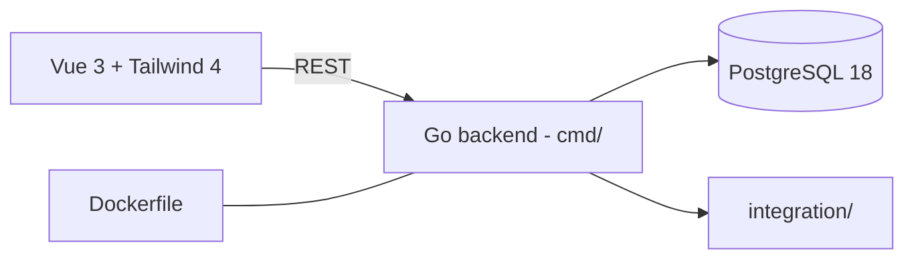

# Payment Receipt v2

> Sistem PR & payment receipt enterprise

| | |
| --- | --- |
| **ID** | `paymentreceipt-v2` |
| **Folder** | `C:/laragon/www/paymentreceipt-v2` |
| **Kategori** | Business & Operations (`business`) |
| **Status** | `active` |
| **Entry point** | `backend/cmd/` |
| **Repository** | <https://github.com/AmirulJusticia0507/paymentreceipt-v2.git> |
| **Stack** | Go 1.26, PostgreSQL 18, Vue 3, Tailwind CSS 4, Docker |
| **Tags** | `finance`, `purchase-requisition`, `receipt`, `rewrite` |

## Ringkasan

Sistem pengajuan dan verifikasi pembelian (*Purchase Requisition* / *Payment Receipt*)
untuk bagian **General Affairs**. Ini adalah **rewrite** dari aplikasi PHP legacy
(`paymentreceipt`) dengan arsitektur modern — bukan refactor.

### Mengapa rewrite (dari README)

| Masalah pada legacy | Dampak |
| --- | --- |
| SQL injection di hampir seluruh handler, tanpa auth guard, delete via GET | Risiko keamanan tinggi |
| File inti hilang (`koneksidb.php`, `template/`) | Aplikasi tidak bisa dijalankan |
| Tanpa test, validasi server-side, atau CI | Tidak terukur |
| 54 MB aset bower/AdminLTE, query bertumpuk, logika di view | Sulit dirawat |

## Fitur Utama

- **Pengajuan pembelian** — alur PR dari pengaju ke verifikator.
- **Verifikasi & approval** — validasi server-side.
- **Receipt** — dokumen pembayaran/terima.
- **Keamanan bertingkat** — auth guard, validasi input (pelajaran dari legacy).

## Arsitektur



Struktur backend Go: `cmd/` (entry), `internal/` (domain & handler), `db/` (migrasi),
`integration/` (test integrasi). Folder `deploy/` dan `scripts/` di root.

**Keputusan penting**

| Keputusan | Alasan |
| --- | --- |
| Go 1.26 | Biner tunggal, cepat, mudah di-deploy |
| PostgreSQL 18 | Integritas transaksi finance |
| `integration/` terpisah | Uji alur end-to-end, bukan hanya unit |
| `.githooks` | Menegakkan pemeriksaan sebelum commit |

## Menjalankan Lokal

Prasyarat: Go 1.26, Node.js, Docker (disarankan), PostgreSQL 18.

```bash
cd C:/laragon/www/paymentreceipt-v2
docker compose up          # stack lengkap
make help                  # daftar perintah (lihat Makefile)
```

## Konfigurasi Environment

Salin `.env.example` → `.env`. Kunci utama: koneksi PostgreSQL dan port aplikasi.

## Dokumentasi Internal Project

- `README.md` — ringkasan & alasan rewrite
- `TODO.md` — termasuk bagian *"Bug Legacy yang Tidak Boleh Diulang"*
- `docs/`
- `AGENTS.md`, `LICENSE`, `CHANGELOG.md` (bila ada)

## Status & Catatan Pemeliharaan

- **Terakhir diaudit**: 2026-10-26
- **Kematangan**: terawat (rewrite terencana, hooks, integration test)
- **Utang teknis**: artefak (`coverage.out`, `.gotmp`, `.tmp-go`, `c.txt`) di root backend sebaiknya di-gitignore
- **Risiko**: migrasi data dari sistem legacy harus diuji paralel
- **Rencana**: migrasi data legacy + cutover bertahap

## Terkait

| Project | Hubungan |
| --- | --- |
| `paymentreceipt` | Aplikasi legacy (PHP) yang digantikan |
| `paymentreceipt-quality` | Working copy QC (branch `agent/quality-guardrails`) dari project ini |
| `paymentreceiptsystem` | Implementasi ERP terpisah (Django) |

## Riwayat

| Tanggal | Perubahan |
| --- | --- |
| 2026-10-26 | Halaman dokumentasi diperkaya dari README dan struktur backend. |
