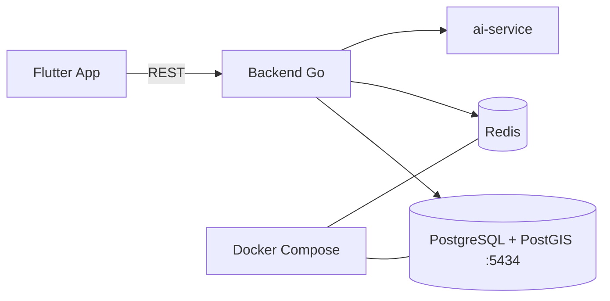

# PresensiGo

> Smart attendance system + mobile app

| | |
| --- | --- |
| **ID** | `presensi-go` |
| **Folder** | `C:/laragon/www/PresensiGo` |
| **Kategori** | Tools & Utilities (`tools`) |
| **Status** | `active` |
| **Entry point** | `backend/cmd/` |
| **Repository** | <https://github.com/AmirulJusticia0507/PresensiGo.git> |
| **Stack** | Go, Flutter, Redis, Docker, PostgreSQL |
| **Tags** | `attendance`, `geofencing`, `mobile` |

## Ringkasan

Sistem absensi pintar: backend Go + database PostgreSQL (image PostGIS) + Redis untuk
rate limiting/cache, dengan aplikasi mobile Flutter (lihat juga project terpisah
`presensi-go-mobile`). Repo ini adalah monorepo yang memuat backend, mobile, dan AI service.

Dikerjakan dengan disiplin tinggi: ada `AUDIT_PROJECT.md`, `UAT_GUIDE.md`, checklist verifikasi,
dan test rate limiting — 85 commit.

## Fitur Utama

- **Presensi berbasis lokasi** — validasi koordinat (PostGIS).
- **Rate limiting** — Redis (lihat `TESTING_REDIS_RATE_LIMITING.md`).
- **Coverage & test terstruktur** — direktori `coverage/`, skrip verifikasi.
- **Mobile app** — Flutter di `presensigo_mobile/`.
- **UAT guide** — panduan uji terima oleh pengguna.

## Arsitektur



**Keputusan penting**

| Keputusan | Alasan |
| --- | --- |
| PostGIS | Validasi radius lokasi presensi |
| Redis | Rate limiting dan pembatasan percobaan |
| Volume terpisah (`postgres_data`) | Data presensi tidak hilang saat container recreate |

## Menjalankan Lokal

Prasyarat: Go, Docker, Node (opsional), Flutter (untuk mobile).

```bash
cd C:/laragon/www/PresensiGo

make setup      # db-up + deps
make dev        # jalankan backend
```

Perintah Make yang tersedia:

| Perintah | Fungsi |
| --- | --- |
| `make setup` | `db-up` lalu `deps` |
| `make db-up` / `db-down` / `db-reset` | Kontrol container Postgres |
| `make db-shell` / `redis-shell` | Masuk ke shell DB/Redis |
| `make dev` / `make build` / `make run` | Backend |
| `make test` | Test Go |
| `make clean` | Bersihkan artefak |

Layanan dari `docker-compose.yml`:

| Service | Port host |
| --- | --- |
| `presensigo-postgres` (postgis 15-3.3) | 5434 |
| `presensigo-redis` (redis 7-alpine) | lihat file |

Inisialisasi DB memakai `backend/migrations/init.sql` (mount ke `docker-entrypoint-initdb.d`).

## Konfigurasi Environment

| Variabel | Default | Keterangan |
| --- | --- | --- |
| `DB_USER` | `presensigo` | User Postgres |
| `DB_PASSWORD` | `presensigo123` | Password (ganti untuk non-lokal) |
| `DB_NAME` | `presensigo` | Nama database |

> Default di atas hanya untuk lingkungan lokal. Jangan dipakai di produksi.

## Dokumentasi Internal Project

- `README.md`, `AUDIT_PROJECT.md`, `UAT_GUIDE.md`, `CONTRIBUTING.md`
- `TESTING_REDIS_RATE_LIMITING.md` — strategi & uji rate limit
- `TASK_*_IMPLEMENTATION.md` / `TASK_*_VERIFICATION.md` — catatan implementasi per tugas
- `backend/LOGGING_STRATEGY.md`, `backend/CORS_IMPLEMENTATION_SUMMARY.md`
- `start-uat.ps1`, `run-tests.ps1`, `dev.ps1`

## Status & Catatan Pemeliharaan

- **Terakhir diaudit**: 2026-10-26
- **Kematangan**: terawat
- **Utang teknis**: banyak artefak build (`*.exe`, `coverage.cov`, `test_output.txt`, `test.log`, folder `30`) di folder backend — sebaiknya di-gitignore
- **Risiko**: kredensial default di compose; pastikan override di setiap lingkungan non-lokal
- **Rencana**: satukan dokumentasi tugas ke `docs/`; bersihkan artefak biner

## Riwayat

| Tanggal | Perubahan |
| --- | --- |
| 2026-10-26 | Halaman dokumentasi diperkaya dari `docker-compose.yml`, `Makefile`, dan README. |
