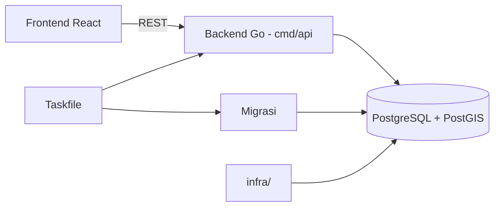

# SiTani DIY

> Portal pertanian & ketahanan pangan DIY

| | |
| --- | --- |
| **ID** | `sitani-diy` |
| **Folder** | `C:/laragon/www/sitani_DIY` |
| **Kategori** | Civic & Public Sector (`civic`) |
| **Status** | `active` |
| **Entry point** | `backend/cmd/api` |
| **Repository** | <https://github.com/AmirulJusticia0507/sitani_DIY.git> |
| **Stack** | Go, React, PostGIS, Docker |
| **Tags** | `agriculture`, `gis`, `food-security`, `diy` |

## Ringkasan

Portal data pertanian dan ketahanan pangan untuk wilayah DIY: peta sebaran lahan, komoditas,
dan indikator ketahanan pangan. Backend Go dengan PostgreSQL/PostGIS, frontend React, dan
orkestrasi tugas lewat `Taskfile.yml`.

Dokumentasi kebutuhan produk sudah tertulis sejak awal (`analisis_kebutuhan.md`),
menandakan project dikerjakan dengan perencanaan, bukan eksperimen.

## Fitur Utama

- **Peta spasial** — visualisasi lahan & komoditas berbasis PostGIS.
- **Data ketahanan pangan** — indikator per wilayah DIY.
- **API Go** — endpoint untuk konsumsi frontend.
- **Migrasi database** — dijalankan lewat task atau Docker.

## Arsitektur



**Keputusan penting**

| Keputusan | Alasan |
| --- | --- |
| Go untuk backend | Performa + deployment tunggal tanpa runtime berat |
| PostGIS | Kebutuhan utama adalah query spasial (lahan, wilayah) |
| `Taskfile.yml` | Satu pintu untuk dev, migrate, dan sejenisnya |

## Menjalankan Lokal

Prasyarat: Go, Node.js, PostgreSQL + PostGIS, Docker (opsional), [Task](https://taskfile.dev/).

```bash
cd C:/laragon/www/sitani_DIY

# Jalankan backend (port dari DEV_BACKEND_PORT di .env)
task dev

# Terapkan migrasi
task migrate
```

`task dev` menjalankan `go run ./cmd/api` di folder `backend` dengan `DB_DSN` yang dirakit
dari variabel Postgres di `.env`.

## Konfigurasi Environment

Dari `dotenv` di `Taskfile.yml`:

| Variabel | Keterangan |
| --- | --- |
| `DEV_BACKEND_PORT` | Port backend saat dev |
| `DEV_FRONTEND_URL` | URL frontend (untuk CORS) |
| `POSTGRES_USER` / `POSTGRES_PASSWORD` / `POSTGRES_HOST_PORT` / `POSTGRES_DB` | Kredensial & nama DB |
| `DB_DSN` | Boleh diisi manual, atau dirakit otomatis dari variabel di atas |

## Dokumentasi Internal Project

- `readme.md` — gambaran umum
- `analisis_kebutuhan.md` — analisis kebutuhan produk
- `todo_list.md` — daftar pekerjaan
- `docs/` — dokumentasi tambahan
- `AGENTS.md` — aturan kerja agent

## Status & Catatan Pemeliharaan

- **Terakhir diaudit**: 2026-10-26
- **Kematangan**: terawat (analisis kebutuhan + todo + task runner)
- **Utang teknis**: `todo_list.md` perlu dipangkas agar mencerminkan status nyata
- **Risiko**: data spasial bergantung kualitas sumber dari instansi
- **Rencana**: tambahkan seed data contoh agar bisa dijalankan tanpa data instansi

## Riwayat

| Tanggal | Perubahan |
| --- | --- |
| 2026-10-26 | Halaman dokumentasi diperkaya dari `Taskfile.yml` dan analisis kebutuhan. |
