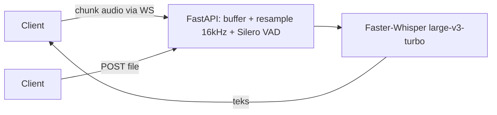

# STT Engine

> Voice-to-Text engine (Faster-Whisper + FastAPI + Vue)

| | |
| --- | --- |
| **ID** | `stt-engine` |
| **Folder** | `C:/laragon/www/stt-engine` |
| **Kategori** | AI & Machine Learning (`ai-ml`) |
| **Status** | `active` |
| **Entry point** | `app/` (FastAPI) · `api/index.py` (Vercel) |
| **Repository** | <https://github.com/AmirulJusticia0507/stt-engine.git> |
| **Stack** | FastAPI, Faster-Whisper, Silero VAD, Vue, Docker |
| **Tags** | `speech-to-text`, `whisper`, `audio`, `websocket` |

## Ringkasan

Engine speech-to-text dengan dua mode operasi:

1. **File upload** — `POST /api/v1/transcribe`.
2. **Streaming** — `WS /ws/v1/transcribe-stream` (PCM 16-bit 16kHz mono, buffer ~1.5 detik).

Alur: klien mengirim chunk audio lewat WebSocket → FastAPI melakukan buffer + resample 16kHz +
Silero VAD → Faster-Whisper (`large-v3-turbo`, FP16/INT8) → teks dikirim kembali.

Memiliki mode **"lite"** untuk deploy di Vercel tanpa GPU.

## Fitur Utama

- **Transkripsi file** — endpoint REST sederhana.
- **Transkripsi real-time** — WebSocket streaming dengan VAD untuk memotong audio senyap.
- **Dukungan GPU** — FP16 untuk akurasi/kecepatan; INT8 untuk CPU.
- **Deploy fleksibel** — Docker/GPU lokal atau Vercel lite-mode.
- **Frontend Vue** — demo pencatatan transkrip.

## Arsitektur



**Keputusan penting**

| Keputusan | Alasan |
| --- | --- |
| VAD Silero sebelum Whisper | Hemat komputasi; hanya segmen bersuara yang ditranskripsi |
| Buffer ~1.5 dtk | Keseimbangan latensi vs akurasi |
| Dual mode file & stream | Satu engine untuk use case rekaman & rapat langsung |
| Mode lite untuk Vercel | Serverless tanpa GPU — model lebih kecil |

## Menjalankan Lokal

Prasyarat: Python 3.10+, Docker (opsional), GPU NVIDIA untuk mode cepat.

```bash
cd C:/laragon/www/stt-engine
pip install -r requirements.txt        # versi CPU: requirements.cpu.txt
docker compose up                      # alternatif: seluruh stack
```

Varian requirement: `requirements.txt` (umum), `requirements.cpu.txt` (CPU), `requirements-vercel.txt` (lite).

## Konfigurasi Environment

Lihat `.env.example`. Model & path data berada di `models/` dan `data/`.

## Dokumentasi Internal Project

- `README.md` — 7 bab (arsitektur, DB, backend, frontend, GPU, status fitur, deploy)
- `Architecture_and_Implementation_Documentation.md`
- `Blueprint System Architecture.txt`

## Status & Catatan Pemeliharaan

- **Terakhir diaudit**: 2026-10-26
- **Kematangan**: terawat (dokumentasi bab-per-bab, blueprint arsitektur)
- **Utang teknis**: mode Vercel & lokal bisa divergen — perlu test bersama
- **Risiko**: ukuran model `large-v3-turbo` besar; mode lite kalah akurasi
- **Rencana**: dukungan diarisasi (pemisahan pembicara)

## Riwayat

| Tanggal | Perubahan |
| --- | --- |
| 2026-10-26 | Halaman dokumentasi diperkaya dari README (7 bab) dan struktur repo. |
