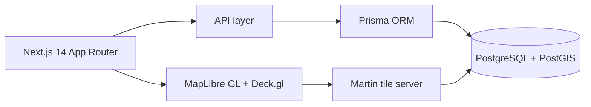

# Terranox OS

> Enterprise spatial & real-estate master plan platform

| | |
| --- | --- |
| **ID** | `terranox-os` |
| **Folder** | `C:/laragon/www/Terranox_OS` |
| **Kategori** | Civic & Public Sector (`civic`) |
| **Status** | `active` |
| **Entry point** | `apps/` |
| **Repository** | <https://github.com/AmirulJusticia0507/Terranox_OS.git> |
| **Stack** | Next.js, Prisma, PostGIS, MapLibre, Deck.gl, Docker |
| **Tags** | `gis`, `spatial`, `real-estate`, `3d` |

## Ringkasan

Platform *spatial intelligence* untuk developer properti skala besar. Menggabungkan pengadaan tanah
(Land Bank), master plan interaktif, ketersediaan unit penjualan real-time, dan analisis kelayakan
investasi berbasis GIS.

## Fitur Utama

- **Land Bank Tracker** — pemetaan digital persil tanah, pelacakan legalitas/sertifikat,
  transparansi status pembebasan lahan.
- **Interactive Master Plan** — peta zonasi cluster & block/lot dengan sinkronisasi status unit.
- **3D Spatial Analytics** — visualisasi topografi & elevasi lahan (*cut and fill*), integrasi model 3D.
- **Spatial Business Intelligence** — analisis jangkauan fasilitas (isochrone), aksesibilitas
  infrastruktur, demografi sekitar.

## Arsitektur



**Stack infrastruktur** (dari README): Next.js 14 App Router, TypeScript, Tailwind CSS,
MapLibre GL JS, Deck.gl; Prisma + PostGIS; Dockerfile terpisah untuk `api`, `web`, dan `martin`.

**Keputusan penting**

| Keputusan | Alasan |
| --- | --- |
| MapLibre (open-source) | Menghindari biaya & vendor lock-in peta komersial |
| Deck.gl | Rendering layer data besar (ribuan persil/unit) |
| Martin untuk vector tiles | Tile server ringan langsung dari PostGIS |
| Prisma | Skema & migrasi konsisten di monorepo |

## Menjalankan Lokal

Prasyarat: Node.js, Docker (atau PostgreSQL + PostGIS lokal).

```bash
cd C:/laragon/www/Terranox_OS
npm install
docker compose up          # stack lengkap (prod: docker-compose.prod.yml)
# atau jalankan web/api secara manual
```

## Konfigurasi Environment

Lihat `.env.example`. Kunci utama: `DATABASE_URL` (PostGIS), konfigurasi tile server Martin,
dan variabel aplikasi web.

Skema database tersedia di `sql/` dan `prisma/`.

## Dokumentasi Internal Project

- `README.md` — modul & stack
- `GOALS.md` — tujuan produk
- `terranox_os_enterprise_gis_architecture.md` — arsitektur GIS
- `setup_db.sql`

## Status & Catatan Pemeliharaan

- **Terakhir diaudit**: 2026-10-26
- **Kematangan**: portofolio (arsitektur GIS terdokumentasi)
- **Utang teknis**: 3 image Docker (api/web/martin) menambah kompleksitas build
- **Risiko**: performa rendering pada dataset besar — perlu uji beban
- **Rencana**: cache tile & optimasi query spasial

## Riwayat

| Tanggal | Perubahan |
| --- | --- |
| 2026-10-26 | Halaman dokumentasi diperkaya dari README dan dokumen arsitektur GIS. |
