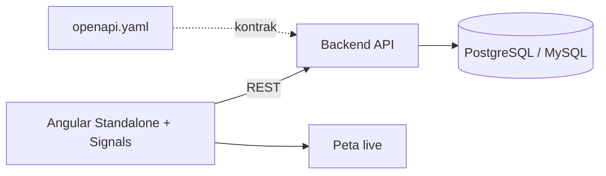

# TRAXIS (Transit Management System)

> MRT & KRL transit management system

| | |
| --- | --- |
| **ID** | `traxis` |
| **Folder** | `C:/laragon/www/TRAXIS` |
| **Kategori** | Civic & Public Sector (`civic`) |
| **Status** | `active` |
| **Entry point** | `src/` (Angular) |
| **Repository** | <https://github.com/AmirulJusticia0507/TRAXIS.git> |
| **Stack** | Angular 17+, TypeScript, RxJS, PostgreSQL/MySQL, SCSS |
| **Tags** | `transit`, `transport`, `live-map`, `dashboard` |

## Ringkasan

Sistem informasi manajemen dan monitoring operasional **real-time** untuk jaringan transportasi
publik MRT dan KRL. Dibangun dengan Angular modern (standalone components + signals),
dilengkapi kontrak API (`openapi.yaml`), skema database (`schema.sql`), dan pemeriksa peta langsung.

## Fitur Utama

- **Monitoring operasional real-time** — status perjalanan & armada.
- **Peta langsung** — disertai skrip verifikasi `live-map-check.mjs`.
- **Kontrak API eksplisit** — `openapi.yaml` sebagai acuan frontend-backend.
- **Skema data tertulis** — `schema.sql` + `TABLES.md` mendokumentasikan entitas.
- **Test** — Jasmine/Karma.

## Arsitektur



**Keputusan penting**

| Keputusan | Alasan |
| --- | --- |
| Angular standalone + signals | State reaktif tanpa NgModule berlapis |
| OpenAPI sebagai sumber kontrak | Menghindari drift antara UI dan API |
| `schema.sql` di repo | Struktur data dapat diaudit & dipulihkan |
| `GUIDELINES.md` / `STYLES.md` | Konsistensi kode dan gaya visual tim |

## Menjalankan Lokal

Prasyarat: Node.js, Angular CLI, database.

```bash
cd C:/laragon/www/TRAXIS
npm install
npm start            # atau: npx ng serve
npm test             # Jasmine/Karma
```

## Dokumentasi Internal Project

- `README.md` — overview & getting started
- `GOALS.md` — tujuan produk
- `GUIDELINES.md`, `STYLES.md` — standar kode & gaya
- `TABLES.md` — dokumentasi tabel
- `openapi.yaml`, `schema.sql` — kontrak API & skema DB
- `FORMS.md`
- `live-map-check.mjs` — pemeriksa peta

## Status & Catatan Pemeliharaan

- **Terakhir diaudit**: 2026-10-26
- **Kematangan**: portofolio (kontrak API + skema + panduan gaya)
- **Risiko**: data real-time memerlukan sumber feed resmi operator
- **Rencana**: tambah mock server dari `openapi.yaml` agar frontend bisa dikembangkan tanpa backend

## Riwayat

| Tanggal | Perubahan |
| --- | --- |
| 2026-10-26 | Halaman dokumentasi diperkaya dari README (tech stack & struktur). |
